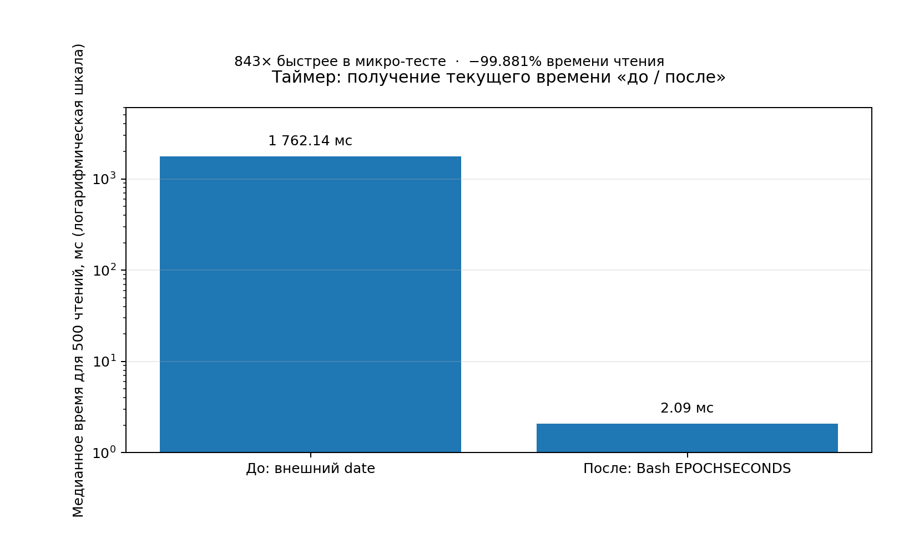

# v716 — сравнение до и после оптимизации чтения времени таймером

## Результат микро-теста

Одинаковый Bash-сценарий выполнил **500 чтений времени за прогон**, по **5 прогонов** каждого варианта. В отчёте используется медиана, чтобы единичные задержки планировщика меньше влияли на сравнение.

| Метрика | До: `now=$(date '+%s')` | После: `now=$EPOCHSECONDS` |
|---|---:|---:|
| Медианное время для 500 чтений | 1762.137 мс | 2.090 мс |
| Диапазон 5 прогонов | 1699.010–1969.472 мс | 1.096–5.442 мс |
| Запуски внешнего `date` на прогон | 500 | 0 |
| Изменение времени чтения | — | **−99.881%** |
| Отношение медиан | — | **843.1× быстрее** |



## Что именно измерено

Это **изолированный микро-тест операции чтения часов**, которую демон таймера выполняет один раз на каждом цикле опроса (примерно раз в секунду). До изменения цикл запускал `date` через command substitution. После изменения он читает встроенную переменную Bash `EPOCHSECONDS`. На Bash, где эта переменная недоступна, оставлен резервный вызов `date`.

Цифры относятся к текущей тестовой среде контейнера, а не к KDE neon пользователя. Они измеряют только получение секундного timestamp, **не полную производительность виджета или демона**. Абсолютное время может отличаться на целевой машине, но количество внешних запусков на штатном Bash 5+ сокращается с одного до нуля на каждый цикл.

## Воспроизведение

Из корня проекта запустить:

```bash
./benchmarks/bench_timer_clock_fastpath.sh 500 5
```

Скрипт выводит CSV с длительностью и количеством внешних запусков `date` для каждого прогона.
