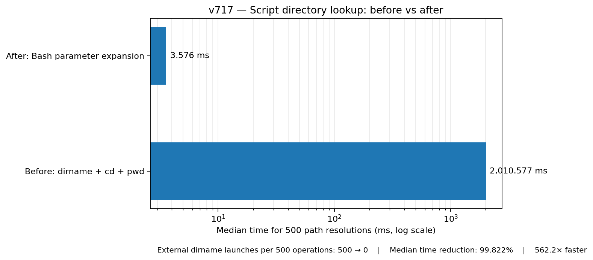

# v717 — script-directory lookup benchmark (before / after)

## Measured results

The same benchmark performed **500 path resolutions per trial**, for **5 trials** per method. Median and range are reported from those five trials.

| Metric | Before: `dirname` + `cd` + `pwd` | After: Bash parameter expansion |
|---|---:|---:|
| Median time for 500 resolutions | 2010.577 ms | 3.576 ms |
| Range across five trials | 1825.437–2468.057 ms | 2.933–4.538 ms |
| External `dirname` processes per trial | 500 | 0 |
| Median operation time change | — | **−99.822%** |
| Ratio of medians | — | **562.2× faster** |



## What changed

`cpu_stats_once`, `mem_stats_once`, and `scripts/system_monitor.d/top_apps.sh` previously built their sibling-library path using a command substitution containing `dirname`, `cd`, and `pwd`. They now take the directory portion of `BASH_SOURCE[0]` with Bash parameter expansion and use `.` when the script path has no slash. No external process is required to prepare the library path.

The variable is used only to source an adjacent library. Therefore an input script path may stay relative instead of being normalized to an absolute path; absolute paths remain absolute, and quoted paths containing spaces work as before.

## Methodology and caveat

The benchmark compares only this directory-resolution operation in a tight Bash loop. It intentionally does **not** claim that a full CPU/RAM/Top Apps widget becomes 562.2 times faster. The end-to-end gain depends on polling cadence and the other work each collector performs. A process-count difference of one `dirname` launch per call is also a deterministic property of the implementation, unlike wall-clock timing.

The CSV with all measurements is `v717_script_dir_benchmark.csv`. Reproduce with:

```bash
./benchmarks/bench_script_dir_fastpath.sh 500 5
```
